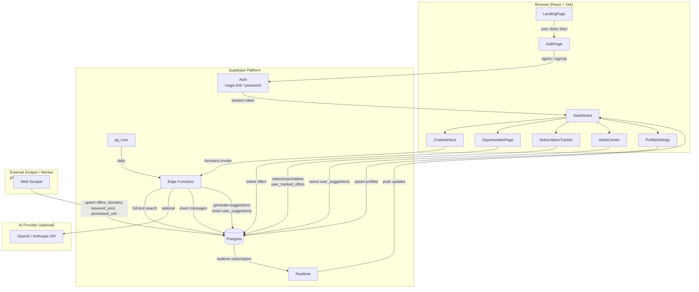
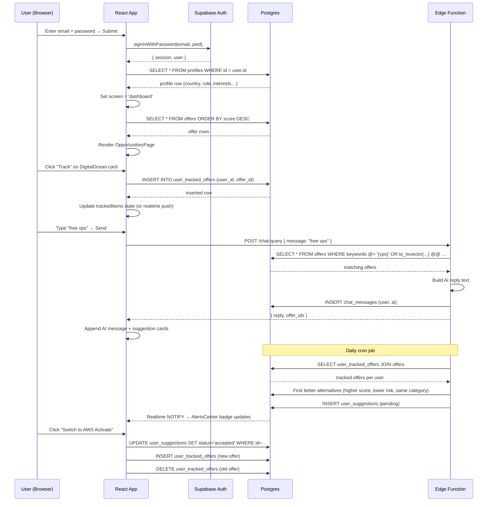

# Smart Offer Finder — Backend Requirements & Architecture

> **Stack**: React + Vite (frontend) · Supabase (Postgres + Auth + Storage + Edge Functions)
> **Date produced**: March 2026

---

## 0. Frontend Application Flow (ASCII)

```
┌─────────────────────────────────────────────────────────────────────────────┐
│                              App.jsx  (root)                                │
│  state: screen | activeTab | trackedItems | suggestions | email             │
└────────────────────────────┬────────────────────────────────────────────────┘
                             │ screen =
          ┌──────────────────┼──────────────────┐
          ▼                  ▼                  ▼
   'landing'            'auth'             'dashboard'
          │                  │                  │
          ▼                  ▼                  │
  ┌───────────────┐  ┌───────────────┐          │
  │  LandingPage  │  │   AuthPage    │          │
  │               │  │               │          │
  │  [Get Started]│  │  email input  │          │
  │       │       │  │  [Continue]   │          │
  └───────┼───────┘  └───────┬───────┘          │
          │                  │                  │
          │ setScreen('auth') │ setScreen(       │
          └──────────────────┘  'dashboard')    │
                                                │
                                                ▼
┌───────────────────────────────────────────────────────────────────────────┐
│                         Dashboard.jsx  (shell)                            │
│                                                                           │
│  ┌──────────────┐   ┌──────────────────────────────────────────────────┐ │
│  │  Sidebar.jsx │   │               Tab Content Area                   │ │
│  │  (desktop)   │   │                                                  │ │
│  │              │   │  activeTab ──────────────────────────────────┐   │ │
│  │  • Assistant │   │       │                                       │   │ │
│  │  • Explore   │◄──┤  setActiveTab()                              │   │ │
│  │  • Tracker   │   │                                               │   │ │
│  │  • Alerts 🔴 │   └────────────────────────────────────────────── │ ──┘ │
│  └──────────────┘                                                   │     │
│                                                                     │     │
│  ┌────────────────┐                                                 │     │
│  │ MobileMenu.jsx │  (hamburger overlay, same nav items)           │     │
│  └────────────────┘                                                 │     │
│                                                                     │     │
│  ┌──────────────────────────────────────────────────────────────────▼──┐  │
│  │                     activeTab switch                                 │  │
│  │                                                                      │  │
│  │  'chat'  ──────►  ┌─────────────────────────────────────────────┐   │  │
│  │                   │  ChatInterface.jsx                           │   │  │
│  │                   │                                              │   │  │
│  │                   │  messages[]  ◄── useState (welcome msg)      │   │  │
│  │                   │       │                                      │   │  │
│  │                   │  user types → handleSend()                   │   │  │
│  │                   │       │                                      │   │  │
│  │                   │       ├─ match MOCK_OPPS keywords            │   │  │
│  │                   │       │       (setTimeout 800ms mock)        │   │  │
│  │                   │       └─► AI message + suggestion IDs        │   │  │
│  │                   │                    │                         │   │  │
│  │                   │                    ▼                         │   │  │
│  │                   │       ChatSuggestionCard.jsx  ×N             │   │  │
│  │                   │       (per matched offer ID)                 │   │  │
│  │                   │       [Track] ──► toggleTrack(id)            │   │  │
│  │                   └─────────────────────────────────────────────┘   │  │
│  │                                              ▲                       │  │
│  │                   ┌─ Right Sidebar (xl) ─────┘                       │  │
│  │                   │  pendingSuggestions[0]                           │  │
│  │                   │  "Switch Plan?" card                             │  │
│  │                   │  [View Comparison] ──► setIsModalOpen(true)      │  │
│  │                   └──────────────────────────────────────────────    │  │
│  │                                                                      │  │
│  │  'opps'  ──────►  ┌─────────────────────────────────────────────┐   │  │
│  │                   │  OpportunitiesPage.jsx                       │   │  │
│  │                   │                                              │   │  │
│  │                   │  MOCK_OPPS ──► filter(search, risk)          │   │  │
│  │                   │       │                                      │   │  │
│  │                   │       ▼                                      │   │  │
│  │                   │  Offer Cards grid (3 cols)                   │   │  │
│  │                   │  [Track] ──► toggleTrack(id)  (App state)    │   │  │
│  │                   └─────────────────────────────────────────────┘   │  │
│  │                                                                      │  │
│  │  'subs'  ──────►  ┌─────────────────────────────────────────────┐   │  │
│  │                   │  SubscriptionTracker.jsx                     │   │  │
│  │                   │                                              │   │  │
│  │                   │  MOCK_OPPS.filter(id ∈ trackedItems)        │   │  │
│  │                   │       │                                      │   │  │
│  │                   │       ▼                                      │   │  │
│  │                   │  Tracked Offer Cards                         │   │  │
│  │                   │  [Remove] ──► toggleTrack(id)  (App state)   │   │  │
│  │                   └─────────────────────────────────────────────┘   │  │
│  │                                                                      │  │
│  │  'alerts' ─────►  ┌─────────────────────────────────────────────┐   │  │
│  │                   │  AlertsCenter.jsx                            │   │  │
│  │                   │                                              │   │  │
│  │                   │  suggestions[] (pending only, from App)      │   │  │
│  │                   │       │                                      │   │  │
│  │                   │       ▼                                      │   │  │
│  │                   │  Upgrade Recommendation cards                │   │  │
│  │                   │  [View Comparison] ──► onViewUpgrade(s)      │   │  │
│  │                   │       └──────────────────────────────────────┼───┼──┤
│  │                   │                                              │   │  │
│  │                   │  + static "Netflix price hike" alert (JSX)   │   │  │
│  │                   └─────────────────────────────────────────────┘   │  │
│  │                                                                      │  │
│  │  'profile' ────►  ┌─────────────────────────────────────────────┐   │  │
│  │                   │  ProfileSettings.jsx                         │   │  │
│  │                   │                                              │   │  │
│  │                   │  props: userEmail, profile{country,role}     │   │  │
│  │                   │  (read-only — no save action yet)            │   │  │
│  │                   └─────────────────────────────────────────────┘   │  │
│  └──────────────────────────────────────────────────────────────────────┘  │
│                                                                             │
│  ┌──────────────────────────────────────────────────────────────────────┐  │
│  │  ComparisonModal.jsx  (z-index overlay, rendered always in DOM)      │  │
│  │                                                                      │  │
│  │  isOpen=false ──► null render                                        │  │
│  │  isOpen=true  ──► modal                                              │  │
│  │                                                                      │  │
│  │  current offer  vs  better offer  (from MOCK_OPPS by id)            │  │
│  │                                                                      │  │
│  │  [Switch]      ──► handleUpgradeAction(id, 'accepted')              │  │
│  │  [Keep Current]──► handleUpgradeAction(id, 'archived')              │  │
│  │  [Track Both]  ──► handleUpgradeAction(id, 'accepted')  ← same btn  │  │
│  │  [✕ close]     ──► setIsModalOpen(false)                            │  │
│  └──────────────────────────────────────────────────────────────────────┘  │
└─────────────────────────────────────────────────────────────────────────────┘


State lifted to App.jsx
────────────────────────────────────────────────────────────────
 trackedItems[]      ──► read by  : Tracker, Chat, Opps, Modal
                    ──► written by: toggleTrack()  (Opps, Chat, Tracker)

 suggestions[]       ──► read by  : Alerts, Dashboard right-sidebar
                    ──► written by: handleUpgradeAction(id, status)

 activeTab           ──► read by  : Dashboard (tab switch)
                    ──► written by: Sidebar, MobileMenu, window event 'changeTab'

 screen              ──► drives   : Landing → Auth → Dashboard
                    ──► written by: onStart, onContinue callbacks

 email               ──► read by  : ProfileSettings, AuthPage
                    ──► written by: onEmailChange in AuthPage
────────────────────────────────────────────────────────────────
```

---

## 1. What the Frontend Currently Needs (Gap Analysis)

### 1.1 Authentication
| Component | Current state | Needs |
|---|---|---|
| `AuthPage.jsx` | Only a single email `<input>` → navigates to dashboard on click | Real Supabase Auth (magic-link **or** email+password). Session token stored and checked on app load. |
| `App.jsx` | `screen` state drives landing → auth → dashboard with no persistence | On refresh the user is thrown back to landing. Needs `supabase.auth.getSession()` check on mount. |

### 1.2 User Profile / Onboarding
| Component | Current state | Needs |
|---|---|---|
| `App.jsx` | `onboardingData` is a hard-coded constant `{ country, role, field, interests }` | A `profiles` table (see §2) storing these values per user. Onboarding should run once after first sign-in. |
| `ProfileSettings.jsx` | Reads `userEmail` and `profile` props, never saves | An editable form that `UPSERT`s into `profiles`. |

### 1.3 Offers Catalogue
| Component | Current state | Needs |
|---|---|---|
| `OpportunitiesPage.jsx` | Filters `MOCK_OPPS` (9 hard-coded items in `mockData.js`) | Fetch rows from `offers` (Supabase). The existing `offers` table is missing 8 display fields — see §2.2. |
| `ChatInterface.jsx` | Keyword-matches against `MOCK_OPPS` locally with `setTimeout` | Either: (a) Supabase full-text search on `offers`, or (b) a Supabase Edge Function calling an LLM. |

### 1.4 Subscription Tracker (Tracked Items)
| Component | Current state | Needs |
|---|---|---|
| `SubscriptionTracker.jsx` | Reads `trackedItems` (in-memory `useState` array of offer IDs) | A `user_tracked_offers` junction table (see §2) so tracked items persist across sessions and devices. |

### 1.5 Alerts / Upgrade Suggestions
| Component | Current state | Needs |
|---|---|---|
| `AlertsCenter.jsx` | Reads a single hard-coded suggestion object in `App.jsx` state | A `user_suggestions` table (see §2) — rows are inserted by backend logic when a better alternative is found for a tracked offer. |
| Hard-coded alert | "Netflix is increasing rates by $2.00 soon" — static JSX | An `alerts` table or a `notification_type` column in `user_suggestions`. |

---

## 2. Supabase Schema Additions (Minimal — no existing table changes except `offers`)

### 2.1 Enable Supabase Auth
No new table required. Enable **Email (magic link or password)** in the Supabase Dashboard → Authentication → Providers.

---

### 2.2 Extend `offers` table (ALTER, not a new table)

The frontend `MOCK_OPPS` data model has these fields that are absent from the current `offers` table:

```sql
ALTER TABLE public.offers
  ADD COLUMN IF NOT EXISTS category     character varying,
  ADD COLUMN IF NOT EXISTS value        character varying,   -- e.g. "$200/yr"
  ADD COLUMN IF NOT EXISTS duration     character varying,   -- e.g. "60 Days"
  ADD COLUMN IF NOT EXISTS risk         character varying CHECK (risk IN ('Low','Medium','High')),
  ADD COLUMN IF NOT EXISTS region       character varying DEFAULT 'Global',
  ADD COLUMN IF NOT EXISTS type         character varying,   -- "Student Perk", "Free Credit", "Trial", …
  ADD COLUMN IF NOT EXISTS keywords     text[],
  ADD COLUMN IF NOT EXISTS auto_renew   character varying DEFAULT 'No',
  ADD COLUMN IF NOT EXISTS cancel_ease  character varying DEFAULT 'Easy',
  ADD COLUMN IF NOT EXISTS total_days   integer,
  ADD COLUMN IF NOT EXISTS expires_at   timestamp with time zone;
```

> `daysLeft` is **always computed on the frontend** as `DATEDIFF(expires_at, NOW())` — do not store it.

---

### 2.3 New table: `profiles`

Stores per-user onboarding/settings data. One row per `auth.uid()`.

```sql
CREATE TABLE public.profiles (
  id          uuid NOT NULL REFERENCES auth.users(id) ON DELETE CASCADE,
  email       text,
  country     character varying DEFAULT 'US',
  role        character varying DEFAULT 'Student',  -- Student | Professional | Founder
  field       character varying,
  interests   text[],
  updated_at  timestamp with time zone DEFAULT now(),
  CONSTRAINT profiles_pkey PRIMARY KEY (id)
);

-- Auto-create a blank profile row when a user signs up
CREATE OR REPLACE FUNCTION public.handle_new_user()
RETURNS trigger LANGUAGE plpgsql SECURITY DEFINER AS $$
BEGIN
  INSERT INTO public.profiles(id, email) VALUES (NEW.id, NEW.email);
  RETURN NEW;
END;
$$;

CREATE TRIGGER on_auth_user_created
  AFTER INSERT ON auth.users
  FOR EACH ROW EXECUTE FUNCTION public.handle_new_user();
```

---

### 2.4 New table: `user_tracked_offers`

Replaces the in-memory `trackedItems` array.

```sql
CREATE TABLE public.user_tracked_offers (
  id         bigserial PRIMARY KEY,
  user_id    uuid NOT NULL REFERENCES auth.users(id) ON DELETE CASCADE,
  offer_id   bigint NOT NULL REFERENCES public.offers(id) ON DELETE CASCADE,
  tracked_at timestamp with time zone DEFAULT now(),
  UNIQUE(user_id, offer_id)
);

-- Row-Level Security
ALTER TABLE public.user_tracked_offers ENABLE ROW LEVEL SECURITY;
CREATE POLICY "Users see own tracked offers" ON public.user_tracked_offers
  FOR ALL USING (auth.uid() = user_id);
```

---

### 2.5 New table: `user_suggestions`

Replaces the hard-coded `suggestions` array in `App.jsx`.

```sql
CREATE TYPE suggestion_status AS ENUM ('pending', 'accepted', 'dismissed', 'archived');

CREATE TABLE public.user_suggestions (
  id           bigserial PRIMARY KEY,
  user_id      uuid NOT NULL REFERENCES auth.users(id) ON DELETE CASCADE,
  current_id   bigint NOT NULL REFERENCES public.offers(id),
  better_id    bigint NOT NULL REFERENCES public.offers(id),
  score        integer DEFAULT 0,
  status       suggestion_status DEFAULT 'pending',
  created_at   timestamp with time zone DEFAULT now()
);

ALTER TABLE public.user_suggestions ENABLE ROW LEVEL SECURITY;
CREATE POLICY "Users see own suggestions" ON public.user_suggestions
  FOR ALL USING (auth.uid() = user_id);
```

---

### 2.6 New table: `chat_messages`

Persists chat history for `ChatInterface.jsx`.

```sql
CREATE TABLE public.chat_messages (
  id         bigserial PRIMARY KEY,
  user_id    uuid NOT NULL REFERENCES auth.users(id) ON DELETE CASCADE,
  sender     character varying NOT NULL CHECK (sender IN ('user','ai')),
  text       text NOT NULL,
  offer_ids  bigint[],                               -- IDs of suggestions shown
  created_at timestamp with time zone DEFAULT now()
);

ALTER TABLE public.chat_messages ENABLE ROW LEVEL SECURITY;
CREATE POLICY "Users see own messages" ON public.chat_messages
  FOR ALL USING (auth.uid() = user_id);
```

---

### 2.7 Canonical Offers Query — Clean / Trusted Data Only

Every frontend component that reads `offers` **must** join against `domains` to exclude blacklisted sources and low-trust domains. This is the single source-of-truth query for any offers feed:

```sql
SELECT o.*
FROM offers o
JOIN domains d ON o.domain = d.domain
WHERE d.is_blacklisted = FALSE
  AND d.trust_score >= 0      -- positive trust only
ORDER BY o.score DESC;
```

**Why this matters**:
- The scraper may ingest offers from domains whose trust has not yet been verified (e.g. `trust_score = 0` is borderline-acceptable; set the threshold higher, e.g. `>= 0.3`, once you have enough domain data).
- A domain can be blacklisted retroactively — without this join, stale spam offers would still appear in the UI.

**How to apply this in the frontend via Supabase JS client**:

```js
// src/lib/queries.js
import { supabase } from './supabase';

export async function fetchTrustedOffers() {
  const { data, error } = await supabase
    .from('offers')
    .select(`
      *,
      domains!inner(domain, trust_score, is_blacklisted)
    `)
    .eq('domains.is_blacklisted', false)
    .gte('domains.trust_score', 0)
    .order('score', { ascending: false });

  if (error) throw error;
  return data;
}
```

> **Note**: The `!inner` syntax forces an inner join — offers whose domain row is missing are automatically excluded.

**Components that must use `fetchTrustedOffers()`** (replacing `MOCK_OPPS`):
| Component | Usage |
|---|---|
| `OpportunitiesPage.jsx` | Main offers grid |
| `ChatInterface.jsx` | Suggestion cards returned by `chat-query` Edge Function |
| `SubscriptionTracker.jsx` | Tracked offers display (join via `user_tracked_offers`) |
| `ComparisonModal.jsx` | Current vs better offer lookup |
| `AlertsCenter.jsx` | `current` and `better` offer lookups for suggestions |

---

## 3. Supabase Edge Functions Required

### 3.1 `chat-query` (replaces the `setTimeout` mock in `ChatInterface.jsx`)

**Trigger**: POST from frontend when user sends a message.

**Logic**:
1. Accept `{ message, user_id }`.
2. Run Postgres full-text search on `offers` (title + description + keywords) matching the message tokens.
3. Optionally call OpenAI / Anthropic API for a natural language response.
4. Return `{ reply: string, offer_ids: number[] }`.
5. Insert both the user message and AI reply into `chat_messages`.

### 3.2 `generate-suggestions` (background / cron)

**Trigger**: Supabase cron (pg_cron) — e.g. daily at 00:00 UTC.

**Logic**:
1. For each user, fetch their `user_tracked_offers`.
2. Find any offer in `offers` with a higher `score`, lower `risk`, or longer duration in the same `category`.
3. Insert a `user_suggestions` row if one doesn't already exist for that pair.
4. This powers the `AlertsCenter` and Dashboard right-sidebar suggestion card.

---

## 4. Frontend Fixes Required

| # | File | Fix |
|---|---|---|
| 1 | `package.json` | Add `@supabase/supabase-js` dependency |
| 2 | `src/lib/supabase.js` *(new)* | Create and export the Supabase client using `VITE_SUPABASE_URL` + `VITE_SUPABASE_ANON_KEY` env vars |
| 3 | `App.jsx` | On mount, call `supabase.auth.getSession()` — redirect to `auth` if no session, `dashboard` if session exists. Subscribe to `onAuthStateChange`. Replace `email` state with session user email. Replace `onboardingData` constant with a fetch from `profiles`. Replace `trackedItems` in-memory array with fetch + realtime from `user_tracked_offers`. Replace `suggestions` with fetch + realtime from `user_suggestions`. |
| 4 | `AuthPage.jsx` | Add password field + "Sign Up / Sign In" toggle. Call `supabase.auth.signInWithPassword()` or `signInWithOtp()` for magic link. Show error state on failure. |
| 5 | `OpportunitiesPage.jsx` | Replace `MOCK_OPPS` import with a `useEffect` fetching `supabase.from('offers').select('*')`. |
| 6 | `SubscriptionTracker.jsx` | Replace `MOCK_OPPS.filter(...)` lookup with `user_tracked_offers` join query. `toggleTrack` should `INSERT` or `DELETE` from `user_tracked_offers`. |
| 7 | `AlertsCenter.jsx` | Replace hard-coded suggestion + Netflix alert with `user_suggestions` fetch. |
| 8 | `ChatInterface.jsx` | Replace `setTimeout` mock with a call to the `chat-query` Edge Function via `supabase.functions.invoke('chat-query', { body: { message: input } })`. Load history from `chat_messages` on mount. |
| 9 | `ProfileSettings.jsx` | Add editable fields for `country`, `role`, `field`, `interests`. Save with `supabase.from('profiles').upsert(...)`. |
| 10 | `.env` *(new)* | Add `VITE_SUPABASE_URL` and `VITE_SUPABASE_ANON_KEY` |
| 11 | `mockData.js` | Can be kept as seed data for Supabase but should no longer be imported in components. |

---

## 5. Row-Level Security Summary

| Table | Policy |
|---|---|
| `profiles` | `auth.uid() = id` |
| `user_tracked_offers` | `auth.uid() = user_id` |
| `user_suggestions` | `auth.uid() = user_id` |
| `chat_messages` | `auth.uid() = user_id` |
| `offers` | Public **read**, no write from client |
| `domains`, `keyword_pool`, etc. | Public **read** (or service-role only write from scraper) |

---

## 6. System Architecture



---

## 7. Data Flow Diagram — Key User Journeys



---

## 8. Environment Variables Needed

```env
# .env (Vite reads variables prefixed with VITE_)
VITE_SUPABASE_URL=https://your-project-ref.supabase.co
VITE_SUPABASE_ANON_KEY=eyJhbGciOiJIUzI1NiIsInR5cCI6IkpXVCJ9...

# Supabase Edge Function secrets (set via supabase secrets set)
OPENAI_API_KEY=sk-...          # only if using LLM in chat-query
```

---

## 9. Priority Order of Implementation

| Priority | Task |
|---|---|
| 🔴 P0 | Wire up Supabase Auth in `AuthPage.jsx` + session check in `App.jsx` |
| 🔴 P0 | Create `profiles`, `user_tracked_offers`, `user_suggestions`, `chat_messages` tables |
| 🔴 P0 | `ALTER offers` to add the 9 missing display columns + seed with `mockData.js` values |
| 🟠 P1 | Replace `MOCK_OPPS` imports in all components with Supabase queries |
| 🟠 P1 | Replace in-memory `trackedItems` with `user_tracked_offers` reads/writes |
| 🟡 P2 | Deploy `chat-query` Edge Function (can start with pure Postgres FTS, add LLM later) |
| 🟡 P2 | Enable Row-Level Security on all user-owned tables |
| 🟢 P3 | Deploy `generate-suggestions` cron Edge Function |
| 🟢 P3 | Enable Realtime on `user_suggestions` for live alert badge |
| 🟢 P3 | Add onboarding flow in `ProfileSettings.jsx` |
